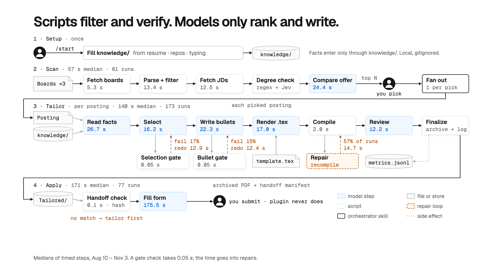

# resume-builder



Find postings, generate a tailored one-page LaTeX resume for any job
description, and (optionally) autofill the application — all from a rich
personal knowledge base plus a set of Claude Code skills.

## The flow at a glance

```
1. Set up      install tectonic + poppler, copy knowledge.example/
2. Fill        /start interviews you, or edit knowledge/ by hand
3. Scan        /scan             new postings since your last scan
4. Read        one table: Company | Role | TC | Location | Posted | Tier | Note
5. Act         pick rows -> tailor only, or tailor + autofill (never submits)
```

Steps 2, 3 and 5 run as slash commands in Claude Code. Scripts do the
fetching, filtering and PDF checks; the model only ranks postings and writes
bullets, and only from facts in `knowledge/`.

### 1. Set up

```bash
brew install tectonic poppler
```

```bash
cp -r knowledge.example knowledge
```

`tectonic` compiles the LaTeX and poppler's `pdftotext` runs the ATS check.
`knowledge/` is gitignored, so your real data never gets committed.

### 2. Fill in `knowledge/`

The richer this is, the better every resume gets. Pick whichever is easiest:

- **Let `/start` do it.** On a fresh clone, `/start` notices placeholder
  files and offers to fill them from:
  - **your existing resume** (PDF, .docx, .tex, .md): it splits it into
    profile, education, skills and one file per role or project, then asks
    about the gaps a resume hides (dates, repo links, the numbers behind a
    bullet);
  - **your repos on this machine**: it reads git history and READMEs to
    draft project files, and you pick which repos are worth a resume line;
  - **past Claude Code / Codex sessions and your GitHub** (optional,
    read-only): used only as leads for questions like "your sessions show a
    caching rewrite in March, what did it speed up?". Nothing goes on the
    resume until you confirm it.

  It then checks each entry has a concrete metric or scale, asks for any that
  are missing, and never invents one.
- **Write it by hand.** Each template in `knowledge.example/` shows the
  format (YAML frontmatter, free prose, seed bullets):

  | File | Holds |
  |---|---|
  | `profile.md` | name, email, links, optional `website:` |
  | `education.md` | school, dates, GPA, coursework. **The degree here drives the scan's degree check** |
  | `skills.md` | your full skill list; it is filtered per JD |
  | `experience/<company-year>.md` | one file per job or internship |
  | `research/<slug>.md` | one file per lab or research role |
  | `projects/<slug>.md` | one file per project; add `repo:` (AI screeners dock unlinked projects) |
  | `rules.md` | optional: selection preferences, scan defaults, archive folder |
  | `current_offer.md` | optional: an offer to compare postings against |
  | `demographics.md` | optional: voluntary EEO answers for the autofiller |

  Write more than fits on a page: metrics, scale, design tradeoffs. The
  tailoring step compresses; the knowledge base remembers.

### 3. Scan: `/scan`

```
/scan        # everything posted since your last scan
/scan 3      # the last 3 days
```

`/scan` pulls the New Grad boards (Simplify plus two speedyapply boards) or
the Internship board, merges and dedupes them, drops what you can't or
needn't apply to, and prints one table. It takes board, categories and
offer comparison from `knowledge/rules.md` instead of asking. `/job-scan` is the same scan with
every option as a flag or an interactive checklist:

```
/job-scan new-grad --swe --dsa --days 7 --compare-offer
```

`/start` runs the same scan after checking setup, so it's the easiest first
command; `/scan` is the quick daily one.

### 4. Read the output

```
| Company | Role                   | TC                         | Location    | Posted | Tier       | Note                                   |
|---------|------------------------|----------------------------|-------------|--------|------------|----------------------------------------|
| Acme    | Software Engineer, New | $150k-$180k + bonus + RSUs | NYC, NY     | 1d     | Better     | payments network; cap: 2 applications  |
| Globex  | ML Engineer I          | ~$140K-$190K (est.)        | Remote, US  | 2d     | Comparable | ad-tech; PhD preferred, BS accepted    |
```

- **TC**: a figure stated on the board or in the JD (bonus/equity appended
  when the JD names them), or a levels.fyi range marked `(est.)`. `—` means
  nothing was findable; a figure is never made up.
- **Posted**: age on the board (`0d` is today).
- **Tier** (only with `--compare-offer`): **Prestigious** (on your list in
  `rules.md`) → **Better** (beats your offer on comp, level or a company you
  prefer) → **Comparable** (FAANG+, near the bar) → **Worth a skim** (no
  clear signal). Rows are sorted in that order, newest first. A posting is
  dropped only when it's clearly worse on every signal, and the report
  counts those drops.
- **Note**: what the company does, plus flags: a degree-check result
  (`PhD preferred, BS accepted`, `advanced-degree flag unverified`), an
  application cap (`cap: 2 applications`), or "applied recently, role
  unconfirmed" when you have a resume for that company but maybe not that
  opening.

Under the table, the report gives scanned vs. surfaced (per source), the
recency window used, and counts of closed, duplicate, already-applied,
excluded and degree-ineligible postings that were removed. Zero counts are
left out. If a source failed to fetch it says so, rather than reporting "0
new postings".

### 5. Act on it

After the table, the scan asks which postings to act on and whether to
**tailor only** or **tailor + apply**. Each pick gets its own subagent, all
started at once. Each one first checks hard blockers against the JD (graduation
year / start date, required degree, visa / citizenship / clearance) and skips
with a reason if you can't take the job, then tailors a one-page PDF, archives
it, and (for apply) fills the form in its own browser tab, stopping at final
review for you to submit. Say "just browsing" to skip this step.

## Tuning what the scan shows

| What | Where | Effect |
|---|---|---|
| Board, categories, recency, offer comparison | "Job scan defaults" in `knowledge/rules.md` | `/scan` uses these silently. `/job-scan` asks for anything missing, then offers to save your answers here |
| Categories | `--swe --pm --dsa --quant` (default set), `--hw` (opt-in) | Simplify's own categories. `--startup` is accepted but filters nothing |
| Recency | `/scan N`, `--days N`, `--since-last-scan` | Since-last-scan reads `knowledge/job_scan_state.json`, which every scan updates |
| Companies you never want to see | `knowledge/excluded_companies.txt`, one per line | Matched by name or whole-word prefix; applies to every scan and the prewarm |
| Already applied | automatic, from `knowledge/metrics.jsonl` and your archive folder | Drops postings you already tailored for. A company match within 3 days drops; from 3 to 30 days the role must also match, otherwise the row stays with a note |
| Degree eligibility | the degree in `knowledge/education.md` | 🎓 postings have their JD read; dropped only if the required degree is above yours. Preferred-only or "or equivalent experience" stays |
| Smarter degree parsing (optional) | `TYPESAFE_API_KEY` in `.env` (copy `.env.example`) | JDs the regex can't classify go to Jev (public JD text only). Without it, the model judges them. `RESUME_BUILDER_JEV=off` disables it |
| Visa / citizenship / clearance | the job-apply plugin's local store (`~/.job-apply`), not `knowledge/` | Asked once per question at act time, then remembered only with your OK |
| Years of experience | nothing to set | Never blocks a posting; noted as a stretch |
| Offer comparison bar | `knowledge/current_offer.md`, or a "Comparison bar" figure in `rules.md` | The bar for Better / Comparable. A flat figure keeps your employer's name out of output |
| Prestige list | a company list in `rules.md` | Those companies rank Prestigious and are never dropped |
| Faster scans | `python3 scripts/install_prewarm_schedule.py install` (`--print` to dry-run) | macOS launchd job at 07:00 and 12:00 that prefetches JDs and comp pages into `~/.cache/resume-builder/` (override with `RESUME_BUILDER_CACHE`). Never advances scan state, tailors or applies. `uninstall` removes it |

**Using Codex (or another agent) instead of Claude Code:** the repo ships an
`AGENTS.md` that points any agent at the same pipeline. In Codex, just ask
"tailor my resume to this JD: <url or paste>" from inside the repo — no
slash command needed. (`/start`'s guided job-scan flow is Claude Code
specific, since it relies on the `AskUserQuestion` tool; other agents can
still drive `tailor-resume`/`apply` directly.)

## Tailoring a single posting

From inside this directory in Claude Code:

```
/tailor https://jobs.example.com/swe-intern-2026
```

or, if the page is JS-rendered / behind a login wall:

```
# paste the JD text into jd.txt, then:
/tailor jd.txt
```

(The command is `/tailor`, not `/resume` — `/resume` is Claude Code's
built-in session-resume command and would shadow it.)

You can also just ask in plain language ("tailor my resume to this JD: …") —
the `tailor-resume` skill triggers on that too.

Output: `build/resume.pdf` (one page, Jake's Resume LaTeX format).

## How it works

1. The `tailor-resume` skill fetches the JD (URL, file, or pasted text).
2. Reads everything under `knowledge/` — your full history in prose form.
3. Scores each experience / research / project by JD relevance.
4. Picks 3–4 experiences + 1–2 projects + filtered skills/coursework to fit one page.
5. Tailors bullets to mirror JD vocabulary (truthfully — never invents).
6. Fills `templates/jakes_resume.tex`, writes `build/resume.tex`, compiles to PDF.
7. Runs an ATS-safety pass (clean text extraction, no garbled ligatures or
   math-mode symbols), checks required JD keywords actually appear in the
   extracted text, and verifies the result is exactly one page.

## Review routing and subscriptions

Evidence citations, numeric grounding, PDF verification, and layout checks
always run locally at every stage. By default, the optional LLM
semantic/readability review runs once on the completed resume rather than once
for selection and again for bullets. This preserves the independent factuality
check while avoiding duplicate review latency and token use.

`scripts/review_routing.py` chooses a safe route without sending a model
prompt: Claude + ChatGPT uses Claude Sonnet to write and Codex Luna to review;
Claude-only and ChatGPT-only installations use a fresh isolated context from
the available provider; no detected subscription requires human review. An
early review is requested only for explicit risk signals (for example,
skills-list evidence or repeated JD mappings). A failed deterministic audit
always skips paid review and must be repaired first.

Choose a mode with `--mode`: `auto` (default), `final-review`,
`full-stage-review` (benchmark/debug), `deterministic-only`, or
`human-review`. On a new clone the tool uses the locally installed `claude`
and `codex` executables as availability hints; it never reads credentials. To
make it explicit, create the gitignored `knowledge/review_routing.json`:

```json
{"claude": true, "chatgpt": false}
```

The routing decision, skips, reviewer telemetry, repair count, and final gate
are append-only in `knowledge/review_routing_runs.jsonl`. A semantic failure
or missing human sign-off blocks archival/delivery rather than silently
falling back to an unreviewed resume.

## Adding a new experience / project

Drop a new markdown file into the right folder:

```
knowledge/
  experience/<company-year>.md      # internships, jobs
  research/<project-slug>.md         # lab / research positions
  projects/<project-slug>.md         # personal / class projects
```

Use any existing file as a template. The richer the prose, the better the
tailoring — include metrics, scale, stakeholders, design tradeoffs, even
material that won't fit on the resume. The AI's job is to compress; the
knowledge base's job is to remember everything.

## Editing the master profile

- `knowledge/profile.md` — name, email, github, linkedin, phone, optional
  `website:` (a filled portfolio URL earns a small bonus with AI screeners)
- `knowledge/education.md` — school, dates, GPA, coursework, honors
- `knowledge/skills.md` — full skill master list (filtered per JD at gen time)
- `knowledge/rules.md` — optional per-person selection & output rules
- `knowledge/demographics.md` — optional voluntary EEO / self-identification
  answers, pronouns, relocation and consent toggles. Purely to stop the
  autofiller asking the same questions on every application. Every field is
  optional: blank means "ask me," and `decline` is a real answer meaning
  "pick the form's decline-to-answer option." Nothing here is ever inferred
  from your name, school, or anything else.

Project files (`knowledge/projects/*.md`) also take:
- `repo:` — bare `github.com/you/project` form; rendered as a visible link
  on the resume in place of a date. AI resume screeners (e.g. HackerRank's
  open-source ATS, see below) deduct per unlinked project, so fill this in
  for any project without an employer/academic exemption.
- `demo:` — optional live-demo URL; a small score boost if set.
- `origin:` — `self` (default, needs a `repo:`), `work`, or `research`
  (the latter two are exempt from the link requirement — no public repo
  expected).

## Scoring against HackerRank's open-source ATS (optional)

HackerRank open-sourced the ATS it uses to triage intern applications
([interviewstreet/hiring-agent](https://github.com/interviewstreet/hiring-agent)).
Run `/ats-score [pdf-path | --all]` to score a built resume (or the whole
archived corpus under `~/Desktop/Tailored Resumes/`) against its public
rubric. First run clones the tool into `tools/hiring-agent/` and sets it up
to use Claude Haiku (needs `ANTHROPIC_API_KEY` in your shell environment or
`tools/hiring-agent/.env`). The scorer is known to be non-deterministic —
treat the output as directional signal (and a checklist of concrete,
fixable deductions like missing project links), never a target score.

## Scan internals

Run `/job-scan [new-grad|internship] [--dsa] [--pm] [--swe] [--quant] [--hw] [--startup] [--days N] [--compare-offer]`
to pull recent postings and print a single lean markdown table. Anything you
don't pass as a flag is asked as an interactive checklist instead — bare
`/job-scan` works fine.

- Sources: Simplify Jobs' community-maintained GitHub boards
  (`SimplifyJobs/New-Grad-Positions`, `SimplifyJobs/Summer2027-Internships`).
  New Grad runs also merge two speedyapply live sources —
  `speedyapply/2027-SWE-College-Jobs` and `speedyapply/2027-AI-College-Jobs`
  (AI/ML + quant-focused, e.g. GTS, Man Group, Flow Traders) — each carrying
  many postings the other two don't. All three are cross-source deduped
  (same company/role collapsed to one row) before filtering. Neither
  speedyapply board is wired in for internship runs. If a speedyapply fetch
  fails, the scan still runs on whatever sources succeeded and says so.
- Categories are Simplify's own: `swe` (Software Engineering), `pm`
  (Product Management), `dsa` (Data Science, AI & Machine Learning), `quant`
  (Quantitative Finance) are the default set; `hw` (Hardware Engineering) is
  opt-in for a narrower audience and not included unless asked for.
  `--startup` is offered as a flag but is always a pass-through — Simplify's
  data has no startup/company-size signal to filter on.
- Parsing is done by `scripts/parse_simplify_jobs.py` and
  `scripts/parse_speedyapply_jobs.py`, not by the model eyeballing raw
  HTML/Markdown — the boards run to 1,000+ rows across several tables, so a
  real parser is both faster and more reliable.
- Cross-source deduping and already-applied filtering run in
  `scripts/merge_and_filter_jobs.py` (unit-tested in
  `scripts/test_merge_and_filter_jobs.py`) rather than being re-derived by
  the model each scan — same thresholds every run, and reproducible.
- Every network fetch (board files, JD pages for degree/salary checks) goes
  through `scripts/fetch_urls.py` (unit-tested in
  `scripts/test_fetch_urls.py`), a small concurrent fetcher rather than
  hand-rolled `curl` prose per call site — one JD is never fetched twice in
  the same scan, one bad URL never sinks the batch, and failure handling is
  identical everywhere it's used.
  "Already applied" is judged primarily from `knowledge/metrics.jsonl`,
  which records the company *and role* of every tailored resume; archived
  PDF filenames are a fallback for runs predating that log. A company match
  alone never drops a posting outside a 3-day window — companies run several
  new-grad postings at once, so an unconfirmed match is surfaced with a note
  instead of being hidden.
- Recency is either a rolling window, `--days N` (default **7**), or
  `--since-last-scan`, which resumes from per-board markers in
  `knowledge/job_scan_state.json`. When a marker has scrolled off the board,
  the fallback window is the time since that board's last scan plus 2 days,
  capped at 14 (`scripts/scan_fallback_days.py`). It's never derived from
  application history, since applications don't happen in posting order.
- Output is always a single table — `Company | Role | TC | Location | Posted
  | Tier | Note` under `--compare-offer` (Tier column dropped otherwise) —
  never grouped prose lists.
- `--compare-offer` judges surfaced postings against
  `knowledge/current_offer.md` (optional, freeform prose — copy
  `knowledge.example/current_offer.md` to fill in), classifying each row
  into Better / Comparable / Worth a skim. The judgment is deliberately
  lenient — it flags a posting whenever it looks better, equal, or just
  unclear, and only stays quiet when a posting reads as a clear step down on
  every signal, so a promising option is never silently filtered out. It
  never fabricates a comp number that isn't in either source.
- Postings carrying the advanced-degree flag (🎓) get their JD checked before
  they reach the table, because board titles hide the requirement — a row
  listed as "Software Engineer Early Career" turned out to require a PhD as a
  minimum qualification. A posting is dropped only when it requires a degree
  above the one in `knowledge/education.md`, so a Master's or PhD candidate
  keeps the rows a bachelor's candidate drops. An unreachable JD keeps the
  posting and marks it unverified rather than dropping it.
- Known **application caps** (some employers limit how many roles you may
  have open at once) are noted per posting, so a scarce slot isn't spent on a
  weak-fit role. The count is only ever taken from the JD, the portal, or
  well-established public policy — never guessed.

After reporting results, `/job-scan` also offers to act on them — the same
triage-then-parallel-subagents flow described in the Quickstart above (list
confirmation, pick postings + tailor/apply, fan out to one subagent per
posting). Answer "just browsing" at that prompt if you only want the scan
output this run. Each fork's eligibility check only blocks on
citizenship/visa/clearance, degree level, or graduation-year/cohort
mismatches against `knowledge/profile.md` / `knowledge/education.md` — a
stated years-of-experience minimum never blocks a fork on its own; a strong
new-grad candidate applies past it regardless.

## Applying with the autofiller (optional)

Web-form filling is handled by the third-party
[job-apply plugin](https://github.com/neonwatty/job-apply-plugin) (MIT), which
drives the [Claude in Chrome](https://chromewebstore.google.com/detail/claude-in-chrome)
extension — no Playwright or API key needed. It supports LinkedIn Easy Apply,
Greenhouse, Ashby, Lever, Rippling, and Workday, and **never submits**: it
always stops at final review and leaves the Submit click to you.

Setup (once):

```bash
claude plugin marketplace add neonwatty/job-apply-plugin
claude plugin install job-apply@neonwatty-plugins
```

plus the Claude in Chrome extension, logged into your job sites.

Run `/app-profile-sync` to push contact/education/experience facts from
`knowledge/` into the plugin's local store (`~/.job-apply/`, plaintext JSON —
treat it like your resume).

Then apply with **`/apply <job-url>`** — the recommended entry point. It
always tailors first (same pipeline as `/tailor`), archives the PDF to
`~/Desktop/Tailored Resumes/`, points the plugin at that exact file, and
fills the application, stopping at final review for you to submit. Never
fill an application with a resume that wasn't tailored for that posting —
calling `/job-apply:job-apply` directly skips that guarantee.

## Layout

```
resume-builder/
├── AGENTS.md                       # entry point for Codex & other agents
├── .claude/
│   ├── commands/start.md           # thin /start wrapper (Claude Code) — recommended entry point
│   ├── commands/job-scan.md        # thin /job-scan wrapper (Claude Code)
│   ├── commands/scan.md            # /scan [days]: job-scan with rules.md defaults
│   ├── commands/tailor.md          # thin /tailor wrapper (Claude Code)
│   ├── commands/ats-score.md       # thin /ats-score wrapper (Claude Code)
│   ├── commands/app-profile-sync.md # thin /app-profile-sync wrapper (Claude Code)
│   ├── commands/apply.md           # thin /apply wrapper (Claude Code)
│   ├── skills/start/               # setup check + thin wrapper around job-scan (/start)
│   │   └── SKILL.md
│   ├── skills/job-scan/            # scan -> triage -> parallel tailor/apply (/job-scan)
│   │   └── SKILL.md
│   ├── skills/tailor-resume/       # the pipeline (person-agnostic)
│   │   └── SKILL.md
│   ├── skills/ats-score/           # optional HackerRank-ATS scoring harness
│   │   └── SKILL.md
│   ├── skills/app-profile-sync/    # syncs knowledge/ into the job-apply plugin store
│   │   └── SKILL.md
│   └── skills/apply/               # tailor-then-autofill orchestrator (/apply)
│       └── SKILL.md
├── knowledge.example/               # placeholder templates (committed)
│   ├── profile.md
│   ├── education.md
│   ├── skills.md
│   ├── rules.md
│   ├── current_offer.md            # optional, used by /job-scan --compare-offer
│   ├── demographics.md             # optional voluntary EEO / autofill answers
│   ├── experience/
│   ├── research/
│   └── projects/
├── knowledge/                      # YOUR full history (gitignored, not committed)
│   ├── profile.md
│   ├── education.md
│   ├── skills.md
│   ├── rules.md                    # optional per-person preferences
│   ├── current_offer.md            # optional, used by /job-scan --compare-offer
│   ├── demographics.md             # optional voluntary EEO / autofill answers
│   ├── experience/                 # one file per role
│   ├── research/                   # one file per research position
│   └── projects/                   # one file per project
├── templates/jakes_resume.tex     # parameterized LaTeX template
├── scripts/
│   ├── parse_simplify_jobs.py      # HTML-table parser used by /job-scan
│   ├── parse_speedyapply_jobs.py   # speedyapply-format parser, shared by both New Grad speedyapply sources
│   ├── merge_and_filter_jobs.py    # cross-source dedupe + already-applied filter
│   ├── test_merge_and_filter_jobs.py
│   ├── fetch_urls.py               # concurrent URL fetcher used by /job-scan and /ats-score
│   ├── test_fetch_urls.py
│   ├── scan_cache.py               # shared on-disk cache for JDs and comp lookups
│   ├── prewarm_scan.py             # scheduled cache prewarm (read-only w.r.t. scan state)
│   ├── install_prewarm_schedule.py # installs/removes the launchd prewarm job
│   ├── check_eligibility.py        # degree-requirement check (regex, optional Jev)
│   ├── extract_comp.py             # stated base/bonus/equity from JD text
│   ├── levels_fyi_est.py           # levels.fyi comp estimates
│   ├── log_metric.py               # appends run records to knowledge/metrics.jsonl
│   ├── run_timer.py                # coarse step timing bridged across a skill's tool calls
│   ├── test_run_timer.py
│   ├── cc_transcripts.py           # reads Claude Code's own transcripts for tokens/model/cost
│   ├── test_cc_transcripts.py
│   ├── build_run_metrics.py        # joins metrics.jsonl + transcripts -> knowledge/runs.jsonl
│   ├── test_build_run_metrics.py
│   ├── metrics_summary.py          # CLI report; --perf and --ab for latency/token/cost stats
│   └── build_metrics_dashboard.py  # renders knowledge/dashboard.html from runs.jsonl
├── build/                           # generated, gitignored
├── tools/hiring-agent/              # cloned by /ats-score on first run, gitignored
├── eval/                            # /ats-score output cache, gitignored
└── README.md
```
